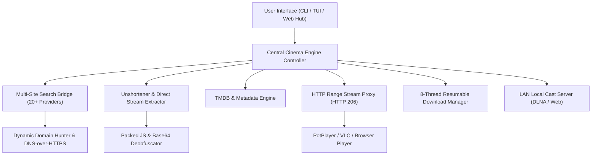

# 🎬 UNSHORTEN CLI & CINEMA ENGINE: EXECUTIVE BLUEPRINT
### Ultra-Fast Multi-Provider Search, Link Unshortening & Universal Media Streaming

---

## 🌟 Project Vision

The **Unshorten CLI & Cinema Engine** is a comprehensive, production-grade terminal tool and web streaming hub designed to eliminate the friction of modern movie and TV show watching:
1. **Zero Adware / Zero Popups / Zero Captcha Hell**: Automatically unshortens multi-stage shortener links (`gplinks`, `droplink`, `hubcloud`, `vcloud`, `gdtot`, `katdrive`) directly in code.
2. **Unified Search Across 20+ Premier Movie Networks**: Searches VegaMovies, KatmovieHD, CineFreak, OlaMovies, KMmovies, HDHub4u, BollyFlix, FMoviess, Movie4K, LookMovie, and more concurrently.
3. **Instant Direct Streaming in PotPlayer / VLC**: Extracts direct streamable MP4/M3U8 links and launches hardware-accelerated playback with auto-loaded subtitles in 1 keypress.
4. **Resumable 8-Thread Turbo Downloader**: Slices downloads into parallel chunks with automatic pause and resume.
5. **Universal Cinema Web Hub**: Serves an OLED True-Black web dashboard accessible from both PC and mobile devices over local LAN.

---

## 🏗️ Core Subsystem Matrix

---

## 📦 Key Component Specifications

| Subsystem | Primary Responsibilities |
|---|---|
| **CLI & TUI (`cli.py`, `interactive.py`)** | Interactive Rich terminal UI with fuzzy searching, color-coded provider badges, quality selectors, and PotPlayer launchers. |
| **Search Bridge (`search.py`)** | Asynchronous multi-site search with compound title normalization (`spiderman` $\rightarrow$ `Spider-Man`) and relevance scoring. |
| **Link Resolver (`resolver.py`)** | Unshortener engine resolving HubCloud, GDToT, KatDrive, FileLions, StreamTape, FastCloud, and Voe links. |
| **Stream Proxy (`remote_hub.py`)** | Reverse proxy supporting HTTP 206 Range requests for seamless video scrubbing in PotPlayer without buffering. |
| **Metadata Engine (`media.py`, `omdb.py`)** | Real-time TMDB / TVmaze / OMDb poster, backdrop, cast, and rating extractor. |
| **Domain Hunter (`domains.py`, `hunter/`)** | Auto-detects domain changes and mirror failovers for all movie sites. |
