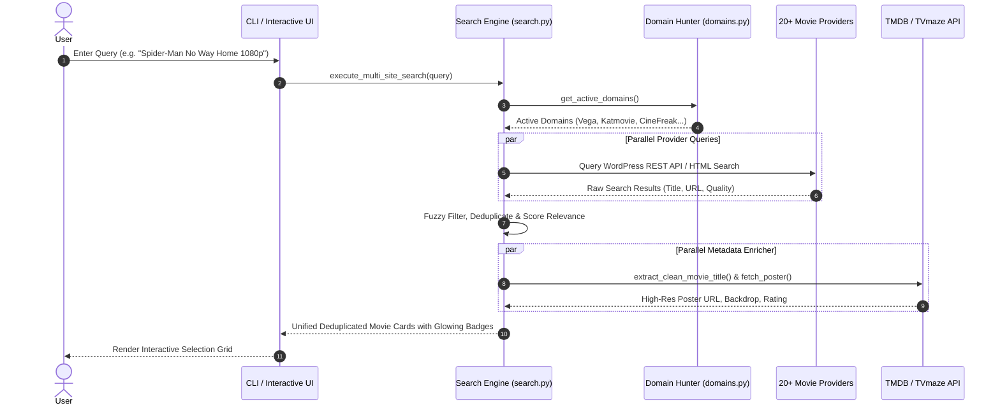
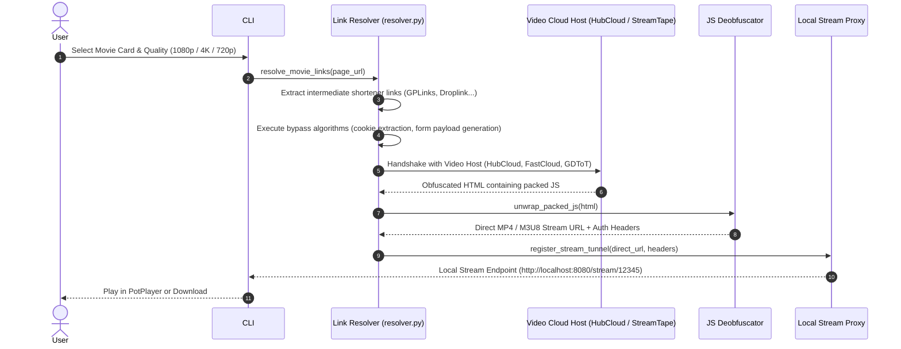
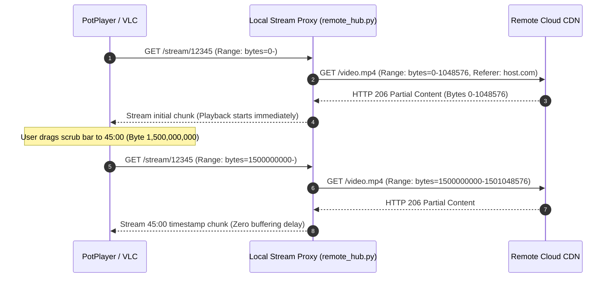

# 📐 MASTER SYSTEM ARCHITECTURE & DATA FLOW SPECIFICATION
### Complete End-to-End Execution Lifecycles for Search, Resolution, Playback & Downloads

---

## 1. The Search & Metadata Pipeline Flow

---

## 2. The Link Resolution & Unshortening Pipeline Flow

---

## 3. The Stream Scrubbing (HTTP 206 Partial Content) Pipeline Flow

