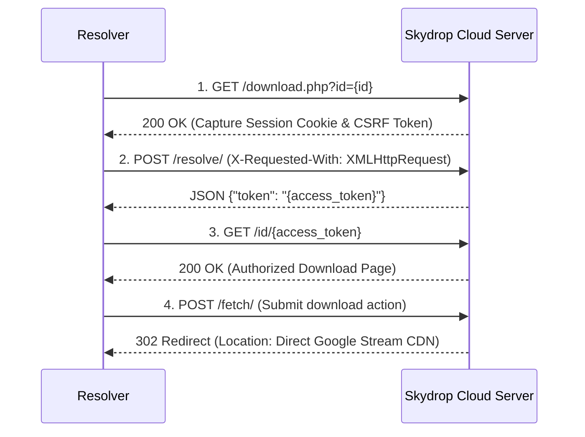
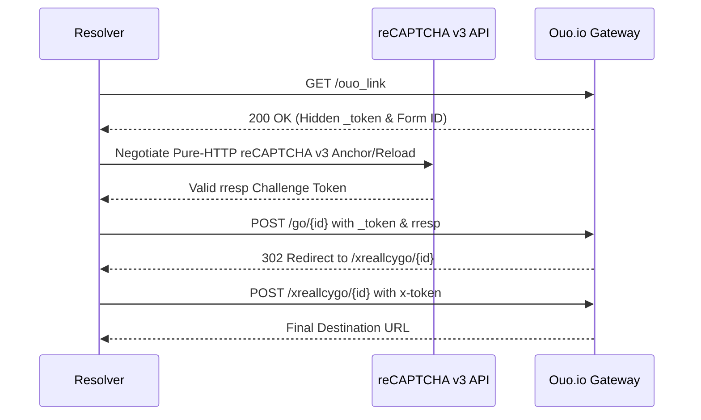

# 🌐 DOMAIN HANDLERS & PROTOCOL HANDSHAKES

---

## 1. File Locker & Direct Media Resolvers (`ripper/resolver/handlers/file_lockers.py`)

### A. Skydrop Cloud Service (`skydrop.sbs`, `skydrop.me`, `skydrop.link`)
Multi-stage state protocol used by `kmmovies.pics`:



---

### B. Streamtape Video Stream Unpacker
- **URL Normalization**: Rewrites embed URL `/e/{id}` to `/v/{id}`.
- **Token Extraction**:
  - Scrapes `norobotlink` inner HTML.
  - Extracts stream host prefix from hidden `div#ideoooolink`.
- **Target URL Reconstruction**:
  ```
  https:/{streamtape_host}&token={extracted_token}&dl=1
  ```

---

### C. KrakenFiles CDN Resolver
1. Extract `input#dl-token` value and `div[data-file-hash]`.
2. Send multipart form POST to `https://krakenfiles.com/download/{hash}`.
3. Parse JSON response to extract high-speed CDN URL (`url` field).

---

### D. Send.cm Direct Link Extractor
1. Extract `id` from `input[name="id"]`.
2. POST to `https://send.cm/` with payload `op=download2&id={id}` and `Referer` set to current page.
3. Intercept HTTP 302 `Location` header to retrieve direct download link.

---

## 2. Ad Shorteners & Gateways (`ripper/resolver/handlers/ad_shorteners.py`)

### A. Ouo.io & Ouo.press 2-Stage Traverser


---

### B. GPLinks 2-Stage Gateway
1. Request initial shortlink; parse `?{vid}` from 302 redirect.
2. Request `https://gplinks.co/{id}/?{vid}` with `Referer: https://mynewsmedia.co/`.
3. Scrape hidden fields from `#go-link`.
4. POST to `/links/go` with `X-Requested-With: XMLHttpRequest` $\rightarrow$ parse `{"url": "..."}` JSON response.

---

### C. Linkvertise Easy Deobfuscator
- If URL contains `?r=...`, extracts query param and applies Base64 decoding.
- Resolves target in **0ms** without triggering ad gates.

---

## 3. Cloud & Drive Bridge Handlers (`ripper/resolver/handlers/gdtot.py`)

### A. GDToT / KatDrive / DriveFire / HubDrive
1. Inject or scrape session `crypt` cookie.
2. Send AJAX POST to `/ajax.php?ajax=download` with payload `{"id": file_id}`.
3. Parse JSON response: extract `gd={drive_id}` or direct Google Drive bridge URL.

### B. Sharer.pw Bridge
1. Scrape `_token` CSRF from page script.
2. Send AJAX POST to `/file/{id}/dl` with payload `_token={token}&nl=1`.
3. Extract direct Google Drive URL from JSON response.

---

## 4. Container & Mirror Decryptors (`ripper/resolver/handlers/filecrypt.py`)

- Unpacks FileCrypt protected folders:
  - Scrapes `/DLC/{id}.dlc` container download URL.
  - Submits container payload to `dcrypt.it/decrypt/paste` API.
  - Extracts unpacked mirror links array.
